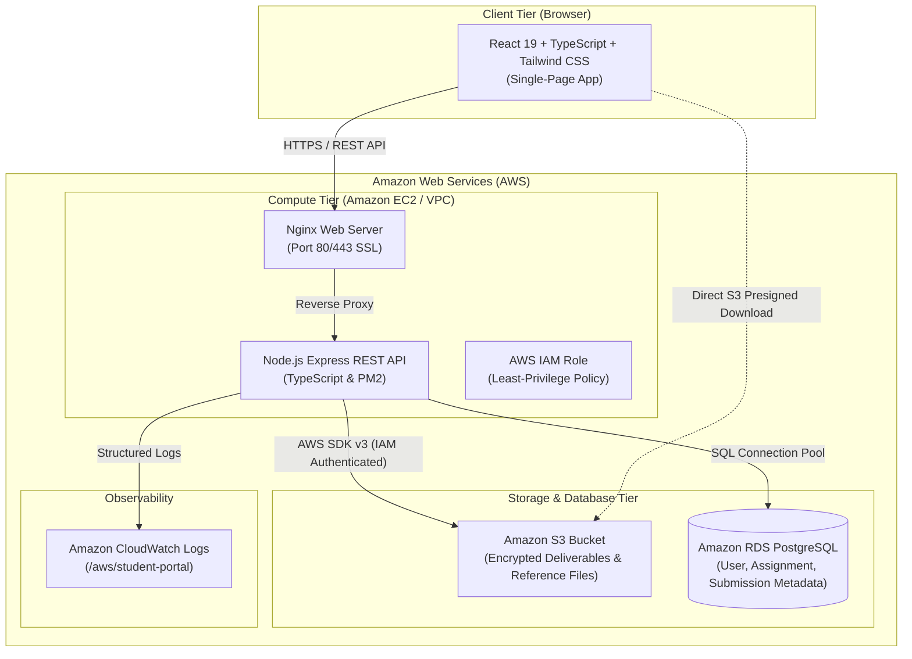

# AWS Student Submission Portal

A secure, responsive, full-stack **Student Submission Portal** designed for cloud deployment on **Amazon Web Services (AWS)**. The application handles student deliverables, faculty grading workflows, administrator platform oversight, and stores all uploaded files securely in **Amazon S3** with metadata tracked in **Amazon RDS for PostgreSQL**.

---

## 🏛️ System Architecture



---

## 🛠️ Technology Stack

### Frontend
- **Framework:** React 19 with Vite & TypeScript
- **Styling:** Tailwind CSS with custom glassmorphism and modern UI components
- **Routing:** React Router DOM (v7) with server-side authorized route guards
- **API Client:** Axios with JWT request/response interceptors
- **Icons:** Lucide React

### Backend
- **Runtime:** Node.js 22 LTS with Express.js (TypeScript)
- **Database Engine:** Amazon RDS for PostgreSQL (with auto-fallback to local SQLite for instant zero-dependency testing)
- **AWS SDK:** AWS SDK for JavaScript v3 (`@aws-sdk/client-s3`, `@aws-sdk/s3-request-presigner`, `@aws-sdk/client-cloudwatch-logs`)
- **Authentication:** JSON Web Tokens (JWT) & bcrypt password hashing
- **Validation:** Zod schemas and centralized error handling

### AWS Infrastructure
- **Amazon EC2:** Hosts Nginx reverse proxy and PM2 Node.js backend
- **Amazon S3:** Private bucket with Server-Side Encryption (SSE-S3), CORS, and Presigned URLs
- **Amazon RDS for PostgreSQL:** Relational database for relational metadata
- **AWS IAM:** EC2 Instance Profile with least-privilege IAM policies
- **Amazon CloudWatch:** Real-time log streaming and audit activity tracking

---

## 👥 User Roles & Permissions

| Feature | Student | Faculty | Administrator |
| :--- | :---: | :---: | :---: |
| Self-Registration | ✅ (Public) | ❌ (Admin-provisioned) | ❌ (Env / Seeded) |
| View Published Assignments & Deadlines | ✅ | ✅ | ✅ |
| Upload & Submit Assignment Deliverables | ✅ | ❌ | ❌ |
| Download Own Submitted Deliverables | ✅ | ✅ | ✅ |
| Create, Edit & Close Course Assignments | ❌ | ✅ | ✅ |
| Upload Assignment Reference Files to S3 | ❌ | ✅ | ✅ |
| Review Student Submissions for Course | ❌ | ✅ | ✅ |
| Record Marks & Written Feedback | ❌ | ✅ | ✅ |
| Control Grade Release (Draft vs. Published) | ❌ | ✅ | ✅ |
| User Account Management (Activate / Deactivate) | ❌ | ❌ | ✅ |
| System Health & CloudWatch Diagnostics | ❌ | ❌ | ✅ |

---

## 🔑 Pre-Seeded Demo Accounts

For immediate evaluation, the database is pre-seeded with realistic courses, deliverables, and submissions:

| Persona | Email | Password | Role Description |
| :--- | :--- | :--- | :--- |
| **Student** | `student@portal.edu` | `StudentPassword123!` | Alex Rivera (STU-2026-001) |
| **Faculty** | `faculty@portal.edu` | `FacultyPassword123!` | Dr. Alan Turing (Computer Science) |
| **Administrator** | `admin@portal.edu` | `AdminPassword123!` | System Administrator |

> 💡 **Quick Switcher:** You can switch between roles in 1-click using the **Role Switcher** in the top navigation bar.

---

## 🚀 Local Development Quickstart

The application is engineered to run out-of-the-box locally without requiring active AWS credentials or local PostgreSQL:

### 1. Start the Backend Server
```bash
cd backend
npm install
npm run dev
```
*The backend server initializes on `http://localhost:5000` with the SQLite database engine and local S3 upload fallback.*

### 2. Start the Frontend Application
```bash
cd frontend
npm install
npm run dev
```
*Access the portal at `http://localhost:5173`.*

---

## ☁️ AWS Cloud Deployment Guide

### Option 1: One-Click AWS CloudFormation Deployment (Recommended)

A CloudFormation template is included in `infrastructure/cloudformation.yaml`. It automatically provisions the VPC, Subnets, Internet Gateway, Security Groups, EC2 instance, S3 Bucket, RDS PostgreSQL, IAM Roles, and CloudWatch Log Group:

```bash
aws cloudformation deploy \
  --template-file infrastructure/cloudformation.yaml \
  --stack-name student-portal-stack \
  --capabilities CAPABILITY_IAM \
  --parameter-overrides \
      DBUsername=dbadmin \
      DBPassword=YourSecurePassword123!
```

After deployment completes, retrieve the public IP and S3 bucket name:
```bash
aws cloudformation describe-stacks \
  --stack-name student-portal-stack \
  --query "Stacks[0].Outputs"
```

---

### Option 2: Step-by-Step EC2 & RDS Manual Deployment

#### 1. Create S3 Bucket
1. Open the Amazon S3 Console and create a private bucket named `aws-student-portal-<your-account-id>`.
2. Enable **Server-Side Encryption (SSE-S3)**.
3. Under **Permissions > CORS configuration**, add:
```json
[
  {
    "AllowedHeaders": ["*"],
    "AllowedMethods": ["GET", "PUT", "POST", "HEAD"],
    "AllowedOrigins": ["*"],
    "MaxAgeSeconds": 3600
  }
]
```

#### 2. Provision Amazon RDS PostgreSQL
1. Launch an Amazon RDS instance with PostgreSQL 16 (Free Tier `db.t4g.micro` or `db.t3.micro`).
2. Attach a security group permitting inbound port `5432` from the EC2 instance's security group.

#### 3. Assign IAM Role to EC2 Instance
Create an IAM Role using the policy defined in `infrastructure/iam-policies.json` and attach it to your EC2 instance. This eliminates the need for hardcoded AWS credentials!

#### 4. Bootstrap the EC2 Server
Connect to your EC2 instance via SSH and run:
```bash
bash infrastructure/ec2-user-data.sh
```

---

## 🔒 Security Best Practices

1. **Direct S3 Presigned URLs:** Files are uploaded and fetched using short-lived (15–60 min) presigned URLs signed with IAM credentials. S3 buckets remain completely private (`BlockPublicAccess: true`).
2. **Strict Server-Side Role Enforcement:** The backend enforces user role checks on every single request using `authenticateToken` and `requireRole(...)`. Roles sent by client requests are ignored.
3. **No Plaintext Secrets:** Passwords are cryptographically hashed using **bcrypt** with salt rounds. Secrets are managed through environment variables and IAM instance profiles.
4. **Input Sanitization:** User inputs are strictly validated and typed using **Zod** schemas, preventing SQL injection and payload exploits.

---

## 📡 REST API Reference

### Authentication (`/api/auth`)
- `POST /api/auth/register` - Register a student account
- `POST /api/auth/login` - Authenticate user & receive JWT token
- `GET /api/auth/profile` - Verify current session & load profile

### Assignments (`/api/assignments`)
- `GET /api/assignments` - List assignments tailored to user role
- `GET /api/assignments/:id` - Fetch assignment details & reference S3 download link
- `POST /api/assignments` - Create assignment with optional reference file (Faculty & Admin)
- `PUT /api/assignments/:id` - Edit assignment parameters (Faculty & Admin)
- `DELETE /api/assignments/:id` - Delete an assignment (Faculty & Admin)

### Submissions (`/api/submissions`)
- `POST /api/submissions/:assignmentId` - Upload deliverable to Amazon S3 (Student)
- `GET /api/submissions/my` - View student submission history & released grades
- `GET /api/submissions/assignment/:id` - List submissions for grading (Faculty & Admin)
- `POST /api/submissions/:id/grade` - Grade submission & save feedback (Faculty & Admin)
- `GET /api/submissions/:id/download` - Generate secure Amazon S3 presigned download URL

### Administration (`/api/admin`)
- `GET /api/admin/stats` - Platform counts, S3 storage metrics & CloudWatch status
- `GET /api/admin/users` - Search and filter user accounts
- `POST /api/admin/users` - Provision an authorized faculty or student account
- `PUT /api/admin/users/:id/status` - Activate or deactivate account access
- `GET /api/admin/submissions` - System-wide submission oversight

---

## 🧪 System Health Probe
Verify server and AWS connectivity at any time:
```bash
curl http://localhost:5000/api/health
```
**Sample Output:**
```json
{
  "status": "healthy",
  "environment": "production",
  "aws": {
    "region": "us-east-1",
    "s3_bucket": "aws-student-submission-portal-bucket",
    "storage_mode": "amazon_s3",
    "cloudwatch": "enabled"
  },
  "database": "postgres"
}
```
