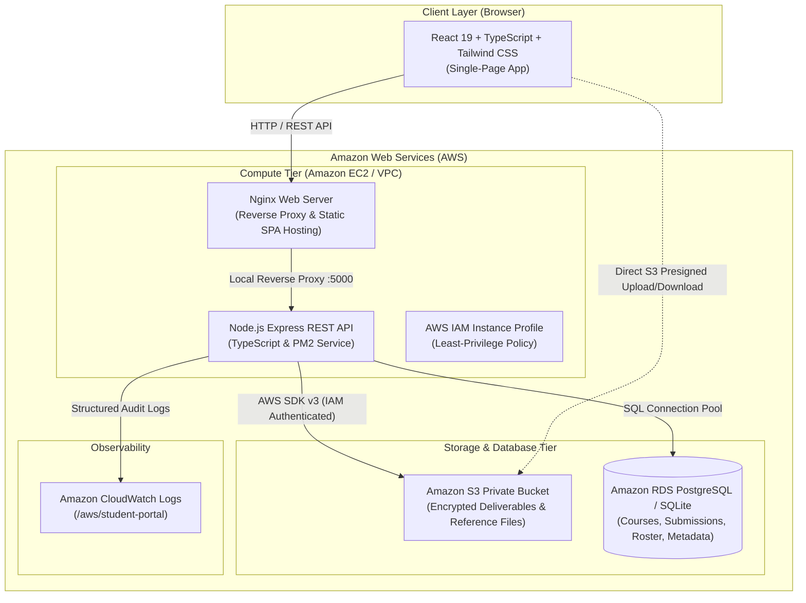

# 🎓 AWS Cloud LMS — Student Submission & Grading Portal

<p align="center">
  
  
  
  
  
  
  
  
</p>

<p align="center">
  <b>A production-ready, cloud-native Learning Management & Student Submission Portal built for Amazon Web Services (AWS).</b><br />
  Handles assignments, real-time grading workflows, role-based access, encrypted file uploads via <b>Amazon S3 Presigned URLs</b>, and dual-mode database support (<b>Amazon RDS PostgreSQL</b> with local <b>SQLite fallback</b>).
</p>

---

## 🌟 Highlights & Features

- ⚡ **Full-Stack Cloud-Native**: React 19 SPA powered by Vite, Tailwind CSS, Lucide icons, and Node.js 22 LTS Express API with TypeScript.
- 🗄️ **Smart Dual-Engine Database**: Runs seamlessly on **Amazon RDS PostgreSQL** in production, with seamless zero-cost **SQLite fallback** for local testing or ultra-low credit budgets.
- 🪣 **Secure Amazon S3 Storage**: Student deliverables (PDFs, ZIPs, Docs) and faculty reference materials stream directly via private AWS IAM Presigned URLs.
- 🛡️ **Role-Based Access Control (RBAC)**: Dedicated, secured workflows for **Students**, **Faculty**, and **Administrators** with instant 1-click persona switching.
- 📜 **Infrastructure-as-Code (IaC)**: Deploy with AWS CloudFormation templates in minutes.
- 📊 **Observability**: Live Amazon CloudWatch logging (`/aws/student-portal`) and built-in system health inspection.
- 💸 **100% Free-Tier Friendly**: Optimized to run entirely within the AWS Free Tier ($0/month) on `t3.micro`.

---

## 🏛️ System Architecture



---

## 👥 User Roles & Capabilities

| Feature | Student | Faculty | Administrator |
| :--- | :---: | :---: | :---: |
| Self-Registration & Profile Management | ✅ | ❌ *(Admin-provisioned)* | ❌ *(Pre-seeded)* |
| Browse Active Courses & Deadlines | ✅ | ✅ | ✅ |
| Upload & Submit Assignment Deliverables | ✅ | ❌ | ❌ |
| Download Own Submitted Deliverables | ✅ | ✅ | ✅ |
| Create, Edit & Close Course Assignments | ❌ | ✅ | ✅ |
| Upload Faculty Reference Files to S3 | ❌ | ✅ | ✅ |
| Review Student Submissions & Download Work | ❌ | ✅ | ✅ |
| Record Marks, Written Feedback & Release Grades | ❌ | ✅ | ✅ |
| Student Roster & User Account Management | ❌ | ❌ | ✅ |
| Cloud Infrastructure Diagnostics & Health Status | ❌ | ❌ | ✅ |

---

## 🔑 Pre-Seeded Instant Demo Accounts

For instant evaluation without creating accounts, the database is pre-seeded with sample courses, assignments, and test accounts:

| Role | Email | Password | Persona Details |
| :--- | :--- | :--- | :--- |
| 🧑‍🎓 **Student** | `student@portal.edu` | `StudentPassword123!` | Alex Rivera (STU-2026-001) |
| 👨‍🏫 **Faculty** | `faculty@portal.edu` | `FacultyPassword123!` | Dr. Alan Turing (Computer Science) |
| 🛡️ **Administrator** | `admin@portal.edu` | `AdminPassword123!` | System Administrator |

> 💡 **Tip:** Use the **Role Switcher** in the navigation bar to toggle between personas in 1-click.

---

## 🚀 Deployment Options on AWS

### Option A: Ultra-Minimal & Free-Tier Stack *(Recommended for Low Credits)*

Saves **80–90% of AWS costs** by running on a single Free-Tier `t3.micro` instance using the built-in SQLite engine and Amazon S3. Deploys in ~90 seconds!

1. Open **[AWS CloudFormation](https://console.aws.amazon.com/cloudformation)**.
2. Click **Create stack** → **With new resources (standard)**.
3. Upload [`infrastructure/minimal-cloudformation.yaml`](./infrastructure/minimal-cloudformation.yaml).
4. Leave `KeyName` empty (use browser-based **EC2 Instance Connect**).
5. Acknowledge IAM capabilities and click **Submit**.
6. When `CREATE_COMPLETE` appears, grab your `EC2PublicIP` and `S3BucketName` from the **Outputs** tab.

---

### Option B: Full Enterprise Cloud Stack

Provisions a complete enterprise architecture including **Amazon RDS (PostgreSQL)**, isolated DB subnets, **Amazon CloudWatch Logs**, S3, VPC, and EC2.

1. In **AWS CloudFormation**, upload [`infrastructure/cloudformation.yaml`](./infrastructure/cloudformation.yaml).
2. Set your `DBPassword` (e.g. `PortalSecurePass2026!`).
3. Set `DBBackupRetentionPeriod` to `1` (Free Tier maximum).
4. Acknowledge IAM capabilities and click **Submit** (~10–12 minutes).

---

### Server Setup on the EC2 Instance

Once connected to your EC2 instance via **EC2 Instance Connect** or SSH:

```bash
# 1. Install Node.js 22 LTS, PM2 & Nginx
sudo apt-get update -y
sudo apt-get install -y curl git nginx build-essential
curl -fsSL https://deb.nodesource.com/setup_22.x | sudo bash -
sudo apt-get install -y nodejs
sudo npm install -g pm2 tsx

# 2. Clone the repository
sudo mkdir -p /var/www/student-portal
sudo chown -R ubuntu:ubuntu /var/www/student-portal
git clone https://github.com/Gnxshxvr/aws-cloud-lms.git /var/www/student-portal
cd /var/www/student-portal
```

#### Configure `.env`:
```bash
nano /var/www/student-portal/backend/.env
```
```env
PORT=5000
NODE_ENV=production
CLIENT_URL=http://<YOUR_EC2_PUBLIC_IP>

# Database Configuration (Choose postgres or sqlite)
DB_TYPE=sqlite

# AWS Storage Configuration (Resolved automatically via EC2 IAM Role)
AWS_REGION=us-east-1
AWS_S3_BUCKET=<YOUR_S3_BUCKET_NAME>
USE_LOCAL_STORAGE=false

# CloudWatch Logging
CLOUDWATCH_ENABLED=false

# Admin Credentials
ADMIN_EMAIL=admin@portal.edu
ADMIN_PASSWORD=AdminPassword123!
ADMIN_NAME=System Administrator
JWT_SECRET=super-secret-jwt-key-student-portal-2026
JWT_EXPIRES_IN=7d
```

#### Build and Launch:
```bash
# 1. Build Backend
cd /var/www/student-portal/backend
npm install
npm run build
pm2 start dist/server.js --name "student-portal-api"
pm2 save
pm2 startup

# 2. Build Frontend
cd /var/www/student-portal/frontend
npm install
npm run build

# 3. Configure Nginx Reverse Proxy
sudo cp /var/www/student-portal/infrastructure/nginx.conf /etc/nginx/sites-available/student-portal
sudo ln -sf /etc/nginx/sites-available/student-portal /etc/nginx/sites-enabled/
sudo rm -f /etc/nginx/sites-enabled/default
sudo nginx -t
sudo systemctl restart nginx
```

---

## 💻 Local Development Quickstart

You can run the entire portal on your local machine with zero AWS configuration required:

```bash
# 1. Start Backend API (runs on SQLite automatically)
cd backend
npm install
npm run dev

# 2. In a second terminal, start the Frontend
cd frontend
npm install
npm run dev
```

Visit **`http://localhost:5173`** in your browser.

---

## 🔒 Security Architecture

1. **S3 Presigned URLs**: Direct-to-browser uploads and downloads through temporary (15-min) cryptographically signed S3 URLs. Buckets block all public access.
2. **Zero Hardcoded Secrets**: On EC2, the AWS SDK automatically queries the **Instance Metadata Service (IMDSv2)** to acquire dynamic, auto-rotating IAM credentials.
3. **Bcrypt Password Hashing**: Passwords are salted and hashed with 10 salt rounds before persistence.
4. **Zod Strict Validation**: All client payloads undergo type and boundary validation before reaching business logic or SQL queries.

---

## 📡 REST API Reference

| Method | Endpoint | Description | Auth Required |
| :--- | :--- | :--- | :---: |
| `POST` | `/api/auth/register` | Self-register as a Student | Public |
| `POST` | `/api/auth/login` | Authenticate user & receive JWT | Public |
| `GET` | `/api/auth/profile` | Retrieve active user profile | Any Token |
| `GET` | `/api/assignments` | List assignments tailored to user role | Any Token |
| `POST` | `/api/assignments` | Create assignment with optional reference file | Faculty / Admin |
| `POST` | `/api/submissions/:assignmentId` | Submit deliverable to Amazon S3 | Student |
| `POST` | `/api/submissions/:id/grade` | Record score & feedback, toggle release | Faculty / Admin |
| `GET` | `/api/submissions/:id/download` | Generate secure S3 presigned download URL | Authorized User |
| `GET` | `/api/admin/stats` | S3 counts, active users & system overview | Admin |
| `GET` | `/api/health` | Service health, DB & AWS connectivity probe | Public |

---

## 📄 License

This project is licensed under the [MIT License](LICENSE).
